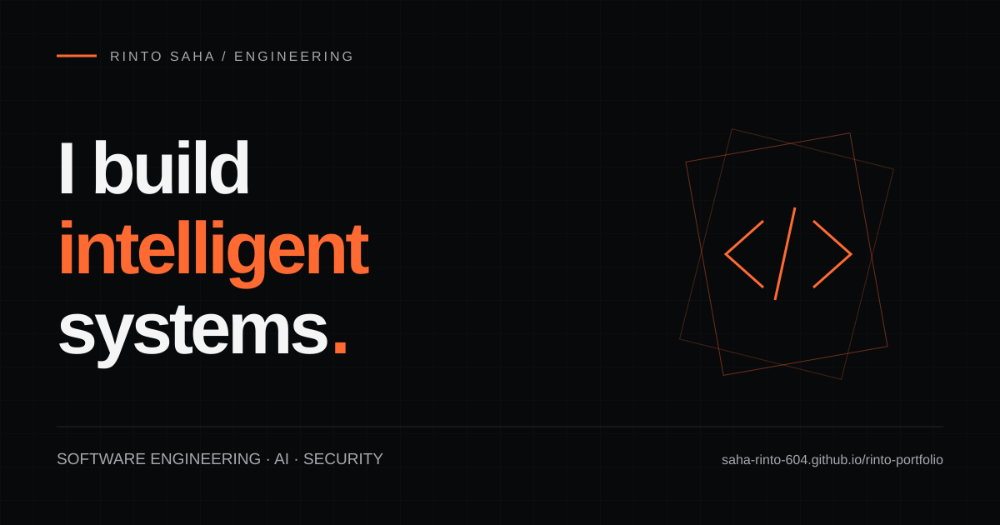

# Rinto Saha

**Software engineering · Applied AI · Security**

Computer Science student building full-stack platforms and exploring how software can handle complex workflows, sensitive data, and intelligent assistance responsibly.

[Portfolio](https://saha-rinto-604.github.io/rinto-portfolio/) · [LinkedIn](https://www.linkedin.com/in/rinto-saha-7853522ab/) · [Repositories](https://github.com/saha-rinto-604?tab=repositories)

## Selected engineering

| Project | What I am building | Technologies |
| --- | --- | --- |
| [Clinora AI](https://github.com/saha-rinto-604/Clinora_AI) | Healthcare workflows, verified medical-report observations, and AI-assisted explanations. In development. | React · Spring Boot · PostgreSQL · FastAPI |
| [SheSafe](https://github.com/saha-rinto-604/SheSafe) | A mobile safety prototype connecting incident reports, location sharing, volunteer response, and messaging. | React Native · Expo · Express · MySQL |
| [ResQher](https://github.com/saha-rinto-604/ResQher) | An earlier Laravel web prototype for community safety and location-based coordination. | PHP · Laravel · Blade · MySQL |

The repository code and documentation describe the current scope. These projects are development work; they do not imply certified clinical or emergency-service deployments.

## Research interests

Software supply-chain security, malicious package detection, applied machine learning, and evidence-grounded AI. I am interested in how static analysis and semantic signals can help reason about software trust. These are research directions, not publication or benchmark claims.

## Tools I work with

- **Languages:** Java, TypeScript, Python, PHP, C, SQL
- **Interfaces:** React, React Native, Next.js, Tailwind CSS
- **Systems:** Spring Boot, FastAPI, PostgreSQL, MySQL
- **Infrastructure:** Git, Docker, RabbitMQ, Redis

## Foundations

- [AI algorithms](https://github.com/saha-rinto-604/Aritifical-Intelligence) — A* search and simulated annealing.
- [Operating systems](https://github.com/saha-rinto-604/Operating-Systems) — shell practice and coursework notes.
- [C programming](https://github.com/saha-rinto-604/Structured_Language_Programming_with_C) — strings, structures, and number algorithms.

## Connect

For engineering conversations, research questions, and collaboration, find me on [LinkedIn](https://www.linkedin.com/in/rinto-saha-7853522ab/) or explore the [source behind my work](https://github.com/saha-rinto-604?tab=repositories).
